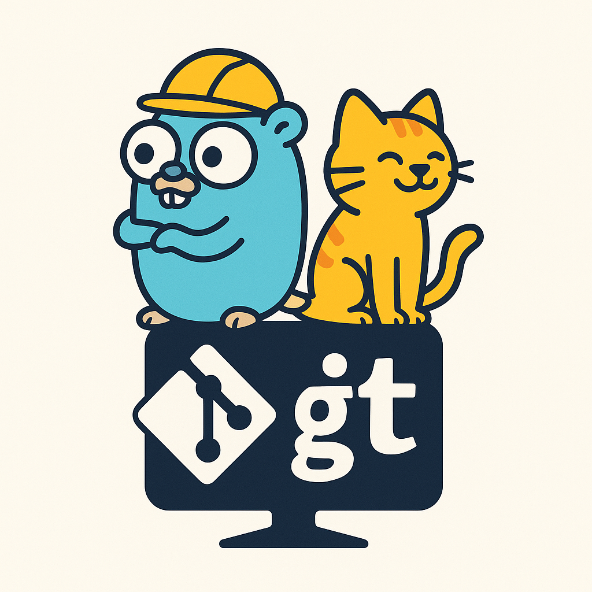

<div align="center">
  
  
  # catmit

  **AI-Powered Git Commit Message Generator**

  [](https://goreportcard.com/report/github.com/penwyp/catmit)
  [](https://opensource.org/licenses/MIT)
  [](https://github.com/penwyp/catmit/releases)
  [](https://golang.org/doc/devel/release.html)
  [](https://github.com/penwyp/catmit)

  *Never struggle with commit messages again! Let AI craft perfect conventional commits for you.*

  [English](README.md) | [中文](README_zh.md)
</div>

## Why Choose catmit?

| Feature | Manual Commits | Other Tools | catmit |
|---------|---------------|-------------|---------|
| **Quality** | Inconsistent | Template-based | AI-powered, contextual |
| **Speed** | Slow thinking | Fast but generic | Fast + intelligent |
| **Conventional Commits** | Manual effort | Basic support | Perfect compliance |
| **Multi-language** | N/A | Limited | Chinese + English |
| **Context Awareness** | Your brain only | Basic | Full git history analysis |
| **Customization** | Full control | Limited | Flexible with multiple providers |

## Features

- **AI-Powered**: Uses advanced LLM to analyze your changes and generate meaningful commit messages
- **Conventional Commits**: Follows conventional commit format with proper type, scope, and description
- **Beautiful TUI**: Interactive terminal interface with real-time progress indicators
- **Multi-Language**: Supports both English and Chinese output
- **Fast & Reliable**: Built in Go with robust error handling and timeout support
- **Flexible Usage**: Works in both interactive and automated (CI/CD) modes
- **Smart Analysis**: Analyzes git history, file changes, and repository context
- **Multiple Providers**: Supports DeepSeek, OpenAI, Azure OpenAI, Anthropic, Gemini, Volcengine Ark, Ollama, and any OpenAI-compatible API

## Usage

### Basic Usage
```bash
# Interactive mode with TUI
catmit

# Auto-commit without confirmation
catmit -y

# Preview message only (dry run)
catmit --dry-run

# Generate in Chinese
catmit -l zh

# Set custom timeout (default: 30s)
catmit -t 60

# Provide seed text for better context (via positional argument)
catmit "fix user authentication"

# Or use the --seed flag (same effect)
catmit --seed "fix user authentication"
```

### Advanced Usage
```bash
# Silent mode (no TUI, direct output)
catmit --dry-run -y

# Combine options
catmit -y -l zh -t 60

# Test your configuration
catmit --dry-run

# Get help
catmit --help

# Check version
catmit --version
```

### Squash Commits

#### Editor Mode (Draft Message)
```bash
# Consolidate multiple commit messages into one (opens editor)
catmit squash-draft

# Skip confirmation, output directly
catmit squash-draft --yes

# Generate in Chinese
catmit squash-draft --lang zh

# Custom timeout
catmit squash-draft --timeout 60

# Dry run mode to preview without copying
catmit squash-draft --dry-run

# Example workflow:
$ catmit squash-draft
# Opens your default editor to input commit messages
# Enter messages one per line, save and exit

# Generated result (automatically copied to clipboard):
feat: implement complete authentication system

- Add user authentication with JWT support
- Fix login error on mobile devices
- Update authentication documentation

Copied to clipboard
```

#### History Mode (Squash Unpushed Commits)
```bash
# Squash unpushed commits using interactive rebase
catmit squash-history

# Skip confirmation (auto-confirm)
catmit squash-history --yes

# Generate in Chinese
catmit squash-history --lang zh

# Custom timeout
catmit squash-history --timeout 60

# Example workflow:
$ catmit squash-history
# Analyzes unpushed commits
# Generates consolidated commit message using AI
# Performs interactive rebase with backup branch creation
# Rebase completed successfully
# Backup branch: backup-feature-branch-20250122-123456
```

**Squash History Features:**
-  **Smart Analysis**: Automatically detects unpushed commits
-  **AI-Generated Messages**: Creates meaningful commit messages from multiple commits
-  **Safety First**: Creates backup branches before making changes
-  **TUI Interface**: Interactive terminal UI for confirmation and monitoring
-  **Base Branch Detection**: Auto-detects main/master as base branch

### Semantic Version Tags

`catmit tag` creates and pushes annotated tags for committed code using only Git. It never calls an LLM, reads project/LLM configuration, stages files, or creates commits. No API key is required; the worktree must be clean when publishing.

```bash
# Default dev prerelease, UTC+8: v1.2.4-dev.1+20261105T153000UTC8
catmit tag

# Full usage, timezone and increment rules
catmit tag --help

# Preview (fetches refs, but does not commit, tag or push)
catmit tag --dry-run

# Capture only the next version, without creating or pushing a tag
version="$(catmit tag --print)"

# Counter-only prerelease: v1.2.4-dev.2
catmit tag --notimestamp

# Release candidate (--pre=rc also works)
catmit tag --pre rc

# UTC or another IANA timezone
catmit tag --timezone UTC
catmit tag --timezone Asia/Tokyo

# Stable release: v1.2.4, without suffixes or timestamp
catmit tag --release
catmit tag --release --bump minor

# Exact name, without automatic suffixes
catmit tag --tag 1.2.4-rc.1

# Another remote, without confirmation
catmit tag --remote upstream --yes
```

**Increment rules:**

- Use the latest remote stable tag reachable from HEAD as the baseline, preserving its `v` or empty prefix. Without version history, use `--initial` (default `v0.1.0`).
- `--bump auto` examines all commits since that stable baseline: breaking changes (`!` or `BREAKING CHANGE`) imply major, `feat` implies minor, otherwise patch. Publishing with non-Conventional Commits requires an explicit `--bump patch|minor|major`. With `--print`, recognized features/breaking changes still determine the bump, otherwise it silently falls back to patch. The initial version is determined by `--initial`.
- Prereleases retain their core target and increment a counter per version/channel. New features/breaking changes may raise the target; explicit `--bump` can select a different release line.
- Example: `v1.2.3 → v1.2.4-dev.1+time → v1.2.4-dev.2+time → v1.2.4-rc.1+time → v1.2.4`. Stable promotion can tag the same tested commit. New fixes after the stable release start `v1.2.5-dev.1`.
- Repeated prereleases of an unreleased commit get new counters. Publishing requires new commits since the stable baseline; `--print` can still calculate the next version, defaulting to a patch bump. Existing tags are never overwritten.
- Timestamps are build metadata after `+` and do not affect precedence. Toggling `--notimestamp` preserves counter ordering; changing metadata alone is not a version upgrade.

**Timezones and flags:**

- `--timezone` defaults to `Asia/Shanghai`: `20261105T153000UTC8`. The same instant is `20261105T073000Z` in `UTC` or `20261105T163000UTC9` in `Asia/Tokyo`.
- IANA daylight-saving offsets are honored. Fractional offsets use SemVer-safe forms such as `UTC5-30`, `UTC5-45` and `UTC-3-30`. The timestamp is fixed when the plan is created.
- Explicit `--timezone` conflicts with `--notimestamp` and `--release` (stable releases have no timestamps).
- `--pre`, `--release` and `--tag` are mutually exclusive. `--tag` also conflicts with `--bump`, `--initial`, `--notimestamp` and `--timezone`.
- Behavior is controlled exclusively by CLI flags. The previous `tag [SEED_TEXT]`, `--seed`, `--lang` and `--stage-all` have been removed; commit your changes first.


**Pipeline output:** `--print` writes exactly one version and a newline to stdout. Errors and `--debug` diagnostics go to stderr; failures exit nonzero. It never prompts, commits, creates tags or pushes. Detached HEAD and dirty worktrees are allowed; only committed history is considered. Publishing-only new-commit and tag-availability checks are skipped, including stable versions already published from other branches. Remote tags are queried once per calculation; their exact commit IDs are resolved locally when available, fetching only missing objects without creating local tags. Shallow clones must first fetch full history, e.g. `git fetch --unshallow --no-tags origin`. `--print` conflicts with `--dry-run` and otherwise accepts the same version/timezone flags.

Printing neither reserves a version nor advances its counter, so repeated calls can produce the same version, especially within one second or with `--notimestamp`. In auto mode, `--print` tolerates non-Conventional Commits: recognized changes determine the bump, otherwise patch is used silently. Use `--bump` to override. `--print` also calculates the next version when HEAD is already the latest stable release, defaulting to a patch bump; only publishing requires new commits.

Build catmit on the CI worker with `go build -o /absolute/path/to/catmit .` in its source directory, then run the binary from the business repository. For example:

```bash
set -e
# Run from the business repository, using the already compiled binary.
if [ -z "${ZHIYAN_PKG_VERSION:-}" ]; then
    ZHIYAN_PKG_VERSION="$(/absolute/path/to/catmit tag --print)"
fi
export ZHIYAN_PKG_VERSION
# BK-CI Shell steps: propagate the value to subsequent pipeline steps.
setEnv "ZHIYAN_PKG_VERSION" "$ZHIYAN_PKG_VERSION"
sh build.sh
```

For catmit itself, GoReleaser marks prereleases automatically and skips Homebrew updates for them.

### Pull Request Creation
```bash
# Create a pull request with AI-generated description
catmit pr

# Create as draft PR
catmit pr --draft

# Specify remote and base branch
catmit pr --remote upstream --base develop

# Skip template usage
catmit pr --template=false

# Check authentication status for all git remotes
catmit check-auth
```

**Supported PR Platforms:**
-  GitHub (via `gh` CLI)
-  GitLab (via `glab` CLI)  
-  Gitea (via `tea` CLI)

**Requirements:**
- For GitHub: `gh` CLI must be installed and authenticated
  - Install: `brew install gh` or visit [cli.github.com](https://cli.github.com)
  - Authenticate: `gh auth login`
- For GitLab: `glab` CLI must be installed and authenticated
  - Install: `brew install glab` or visit [gitlab.com/gitlab-org/cli](https://gitlab.com/gitlab-org/cli)
  - Authenticate: `glab auth login`
- For Gitea: `tea` CLI must be installed and authenticated
  - Install: `brew install tea` or visit [gitea.com/gitea/tea](https://gitea.com/gitea/tea)
  - Authenticate: `tea login add`

### PR Template Support

catmit supports both repository templates and custom configuration templates:

**Repository Template Locations** (auto-detected):
1. `.github/pull_request_template.md`
2. `.github/PULL_REQUEST_TEMPLATE.md`
3. `docs/pull_request_template.md`
4. `PULL_REQUEST_TEMPLATE.md`

**Custom Template Support**:
catmit automatically detects PR templates from standard repository locations (`.github/pull_request_template.md`, etc.) and uses them when creating pull requests.

**Features:**
-  Auto-detection of PR template files
-  Template variables substitution:
  - `{{.CommitMessage}}` - Your generated commit message
  - `{{.Branch}}` - Current branch name
  - `{{.BaseBranch}}` - Target base branch
  - `{{.Date}}` - Current date
-  Disable with `--pr-template=false` if needed

**Example Template:**
```markdown
## Description
{{.CommitMessage}}

## Type of Change
- [ ] Bug fix
- [ ] New feature
- [ ] Breaking change

## Testing
- [ ] Tests pass locally
- [ ] New tests added

Branch: {{.Branch}} → {{.BaseBranch}}
```

### Advanced PR Options

catmit provides comprehensive control over pull request creation:

**All PR Flags:**
```bash
# Create PR with all options
catmit pr \
  --remote upstream \
  --base develop \
  --draft \
  --provider github

# Generate commit message first, then create PR
catmit --yes  # Commit with AI-generated message
catmit pr     # Create PR for the committed changes
```

**Fork Workflow Support:**
```bash
# Working on a fork? Push to origin and create PR to upstream
git remote -v  # origin (your fork), upstream (original repo)
catmit pr --remote upstream

# Or use the shorthand
catmit pr -r upstream
```

**Multi-Remote Scenarios:**
```bash
# List all remotes and their providers
catmit check-auth

# Create PR to specific remote
catmit pr --remote company

# Create PR for existing branch
catmit pr  # Will create PR without pushing if branch exists
```

**Provider Detection:**
- Auto-detects from git remote URL
- Maps custom hosts via `~/.config/catmit/providers.yaml`
- Override with `--provider` when needed
- Supports GitHub Enterprise and self-hosted GitLab

### Interactive Demo
```
$ catmit
 Analyzing repository...
 Processing 3 staged files...
 Generating commit message...

┌─ Generated Commit Message ─────────────────────────────────┐
│ feat(auth): implement OAuth2 integration with GitHub       │
│                                                             │
│ - Add GitHub OAuth2 provider with scope configuration      │
│ - Implement secure token storage with encryption           │
│ - Add user profile synchronization from GitHub API         │
│ - Update login flow to support OAuth2 redirect             │
│                                                             │
│ Resolves #145                                              │
└─────────────────────────────────────────────────────────────┘

 Commit this message? [Y/n]: y
 Committed successfully!
```

## Installation

### Installation Methods

#### Using Homebrew (macOS/Linux)
```bash
brew tap penwyp/catmit
brew install catmit
```

#### Using Go
```bash
go install github.com/penwyp/catmit@latest
```

#### Download Binary
Download the latest release from [GitHub Releases](https://github.com/penwyp/catmit/releases) for your platform.

#### Verify Installation
```bash
catmit --version
```

### Quick Setup

1. **Choose your LLM provider** (see [LLM Provider Configuration](#llm-provider-configuration) below)
2. **Set environment variables** for your chosen provider
3. **Make some changes and stage them:**
   ```bash
   git add .
   ```
4. **Generate and commit:**
   ```bash
   catmit
   ```

## LLM Provider Configuration

catmit supports multiple LLM providers through three environment variables. Configure them based on your preferred provider:

### DeepSeek (Default & Recommended)
```bash
# Required
export CATMIT_LLM_API_KEY="sk-your-deepseek-api-key"

# Optional (these are the defaults)
export CATMIT_LLM_API_URL="https://api.deepseek.com/v1/chat/completions"
export CATMIT_LLM_MODEL="deepseek-chat"
```

**Get your API key:** [DeepSeek Console](https://platform.deepseek.com/api_keys)

### Volcengine Ark
```bash
# Required
export CATMIT_LLM_API_KEY="your-volcengine-api-key"
export CATMIT_LLM_API_URL="https://ark.cn-beijing.volces.com/api/v3/chat/completions"
export CATMIT_LLM_MODEL="deepseek-v3-250324"
```

**Get your API key:** [Volcengine Ark Console](https://console.volcengine.com/ark)

### OpenAI
```bash
# Required
export CATMIT_LLM_API_KEY="sk-your-openai-api-key"
export CATMIT_LLM_API_URL="https://api.openai.com/v1/chat/completions"
export CATMIT_LLM_MODEL="gpt-4"
```

**Get your API key:** [OpenAI API Keys](https://platform.openai.com/api-keys)

### Azure OpenAI
```bash
# Required
export CATMIT_LLM_PROVIDER="azure"
export CATMIT_LLM_API_KEY="your-azure-api-key"
export CATMIT_LLM_API_URL="https://your-resource.openai.azure.com"
export CATMIT_LLM_MODEL="your-deployment-name"
```

**Setup:**
1. Get your API key from [Azure OpenAI Service](https://azure.microsoft.com/en-us/products/ai-services/openai-service)
2. Replace `your-resource` with your Azure OpenAI resource name
3. Replace `your-deployment-name` with your model deployment name (e.g., `gpt-4`, `gpt-35-turbo`)

### Anthropic
- Set `CATMIT_LLM_PROVIDER=anthropic`.
- Uses `CATMIT_LLM_API_KEY`; optional `CATMIT_LLM_API_URL` (default `https://api.anthropic.com/v1/messages`).
- `CATMIT_LLM_MODEL` defaults to `claude-3-sonnet-20240229`.
- Streaming supported via SSE.

### Gemini
- Set `CATMIT_LLM_PROVIDER=gemini`.
- Uses `CATMIT_LLM_API_KEY`; API URL defaults to `https://generativelanguage.googleapis.com/v1beta/models/{model}:generateContent`.
- `CATMIT_LLM_MODEL` defaults to `gemini-pro`.
- Streaming supported via `:streamGenerateContent`.

### Ollama
- Set `CATMIT_LLM_PROVIDER=ollama`.
- Local HTTP API, no API key required.
- `CATMIT_LLM_API_URL` defaults to `http://localhost:11434/api/chat`.
- `CATMIT_LLM_MODEL` defaults to `llama2`.
- Ensure the local Ollama server is running.

### Other OpenAI-Compatible Providers
```bash
# Required - adjust for your provider
export CATMIT_LLM_API_KEY="your-api-key"
export CATMIT_LLM_API_URL="https://your-provider.com/v1/chat/completions"
export CATMIT_LLM_MODEL="your-model-name"
```

### Local AI CLI Tools (Experimental)
catmit can use local AI CLI tools instead of API calls. This is useful if you have Claude Code, Gemini CLI, Qwen Code, AIChat, or other AI CLI tools installed:

```bash
# Required - both must be set
export CATMIT_LLM_PROVIDER="cli"
export CATMIT_LLM_CLI_TOOL="claude"  # or absolute path like /usr/local/bin/claude

# Supported tools (use binary name or full path):
# - claude (Claude Code CLI)
# - cursor-agent (Cursor Agent CLI)
# - gemini (Gemini CLI)
# - qwen, qwen-code (Qwen Code)
# - aichat (AIChat tool)
# - ollama (Ollama with model)
# - Any other CLI tool that accepts prompts via stdin or arguments

# For Ollama, you can specify the model
export CATMIT_LLM_MODEL="llama2"  # Optional, defaults to llama2
```

**Usage Examples:**
```bash
# Using Claude Code
export CATMIT_LLM_PROVIDER=cli
export CATMIT_LLM_CLI_TOOL=claude
catmit

# Using Cursor Agent
export CATMIT_LLM_PROVIDER=cli
export CATMIT_LLM_CLI_TOOL=cursor-agent
catmit --timeout 60

# Using Gemini CLI
export CATMIT_LLM_PROVIDER=cli
export CATMIT_LLM_CLI_TOOL=gemini
catmit
```

**Important Notes:**
- **No fallback**: If the CLI tool fails, catmit will exit (no automatic fallback to API)
- **User control**: You must explicitly set both environment variables
- **Tool verification**: catmit will verify the tool exists and is executable on startup
- **Authentication**: CLI tools use their own authentication (no API key needed)
- **Timeout**: Some CLI tools may need longer timeouts than the default 20 seconds

### Environment Variables Reference

| Variable | Description | Required | Default |
|----------|-------------|----------|---------|
| `CATMIT_LLM_PROVIDER` | LLM provider type (`azure`, `anthropic`, `gemini`, `ollama`, `cli`, or leave empty for OpenAI-compatible) |  No | OpenAI-compatible |
| `CATMIT_LLM_API_KEY` | API key for your chosen provider (not needed for CLI provider) |  Yes* | - |
| `CATMIT_LLM_API_URL` | API endpoint (full URL for OpenAI-compatible, base URL for Azure) |  No | `https://api.deepseek.com/v1/chat/completions` |
| `CATMIT_LLM_MODEL` | Model name (for OpenAI-compatible) or deployment name (for Azure) |  No | `deepseek-chat` |
| `CATMIT_LLM_CLI_TOOL` | CLI tool binary name or absolute path (required when `PROVIDER=cli`) |  Yes** | - |

\* Required for API providers (OpenAI-compatible, Azure), not needed for CLI provider
\*\* Required only when `CATMIT_LLM_PROVIDER=cli`

### Provider Mapping Configuration

catmit automatically detects git hosting providers through a configuration file. The default configuration maps common git hosts to their respective platforms:

**Configuration File Location**: `~/.config/catmit/providers.yaml`

This file is automatically created on first run with default mappings. You can customize it to add your own git hosting services:

```yaml
# Default provider mappings
hosts:
  github.com: github
  gitlab.com: gitlab
  bitbucket.org: bitbucket
  # Add custom enterprise hosts
  git.company.com: github    # GitHub Enterprise
  gitlab.internal.com: gitlab # GitLab self-hosted
```

**Features**:
-  Auto-detection of PR provider based on git remote URL
-  Hot-reload: Changes take effect immediately without restart
-  Enterprise support: Map your internal git hosts to supported providers
-  Override with `--pr-provider` flag when needed

## How It Works

1. ** Repository Analysis**: Scans recent commits, branch info, and current staged changes
2. ** Smart Context Building**: 
   - Intelligent file prioritization based on change importance
   - Token budget management for large diffs
   - Untracked file analysis and inclusion
   - Concurrent Git operations for performance
3. ** AI Generation**: Sends optimized context to your chosen LLM provider for intelligent message generation
4. ** Quality Assurance**: Validates conventional commit format and provides interactive review
5. ** Smart Commit**: Executes git commit with the generated message

### Advanced Features

**Intelligent Change Analysis:**
- **File Priority Scoring**: Automatically prioritizes important files (configs, main files, tests) over less critical ones
- **Token Budget Management**: Smartly truncates large diffs to fit within LLM context limits while preserving key information
- **Untracked File Support**: Includes new files in analysis for comprehensive commit messages
- **Change Magnitude Detection**: Categorizes changes as small/medium/large to guide commit message detail level
- **Suggested Commit Prefixes**: AI suggests appropriate conventional commit types (feat/fix/docs/refactor) based on changes

## Before & After Examples

### Before catmit (Manual)
```bash
git commit -m "fix bug"
git commit -m "update stuff"  
git commit -m "changes"
git commit -m "wip"
```

### After catmit (AI-Generated)
```bash
fix(auth): resolve token validation race condition

- Add mutex to prevent concurrent token refresh
- Update error handling for expired tokens
- Improve test coverage for edge cases

Closes #123
```

```bash
feat(ui): add dark mode toggle with system preference detection

- Implement theme context with localStorage persistence
- Add CSS variables for consistent color management
- Create toggle component with smooth transitions
- Support system preference auto-detection

Resolves #89
```

## Development

### Prerequisites
- Go 1.22+
- Git
- LLM API key (DeepSeek recommended)

### Building from Source
```bash
git clone https://github.com/penwyp/catmit.git
cd catmit
make build
```

### Running Tests
```bash
# Run all tests
make test

# Run with coverage
go test -coverprofile=coverage.out ./... && go tool cover -func=coverage.out

# Run E2E tests
make e2e

# Lint code
make lint
```

### Project Structure
```
catmit/
├── pkg/           # Public packages
│   ├── gitinfo/   # Git operations and data collection
│   ├── llm/       # LLM provider clients with OpenAI-compatible support
│   └── prompt/    # Prompt template builder with language support
├── internal/      # Internal packages
│   ├── app/       # Application dependencies and providers
│   ├── cli/       # CLI tool detection and management
│   ├── config/    # YAML configuration management
│   ├── errors/    # Custom error types
│   ├── git/       # Git operations (commit, push, stage)
│   ├── pr/        # Pull request creation logic
│   ├── provider/  # Git provider detection (GitHub, GitLab)
│   ├── squash/    # Commit squashing functionality
│   ├── template/  # PR template management
│   ├── ui/        # Bubble Tea TUI components
│   └── workflow/  # Workflow orchestration
├── cmd/           # Cobra CLI commands
├── test/e2e/      # End-to-end tests
└── docs/          # Documentation
```

## Security

- **API Keys**: Never commit API keys to repositories. Use environment variables or secure key management.
- **Code Privacy**: Only git diffs are sent to LLM providers, not your entire codebase.
- **Network**: All API calls use HTTPS encryption.

## Contributing

We welcome contributions! Please see our [Contributing Guide](CONTRIBUTING.md) for details.

1. Fork the repository
2. Create your feature branch (`git checkout -b feature/amazing-feature`)
3. Make your changes and add tests
4. Ensure tests pass (`make test`)
5. Commit using catmit (`catmit`)
6. Push to the branch (`git push origin feature/amazing-feature`)
7. Open a Pull Request

## License

This project is licensed under the MIT License - see the [LICENSE](LICENSE) file for details.

## Acknowledgments

- [DeepSeek](https://www.deepseek.com/) for providing excellent AI capabilities
- [OpenAI](https://openai.com/) for pioneering the API standards
- [Volcengine](https://www.volcengine.com/) for reliable cloud AI services
- [Bubble Tea](https://github.com/charmbracelet/bubbletea) for the amazing TUI framework
- [Cobra](https://github.com/spf13/cobra) for the CLI framework
- [Conventional Commits](https://www.conventionalcommits.org/) for the commit standard

---

<div align="center">
  Made with ❤️ by <a href="https://github.com/penwyp">penwyp</a>
  
  If catmit helped you, please consider giving it a ⭐!
</div>
